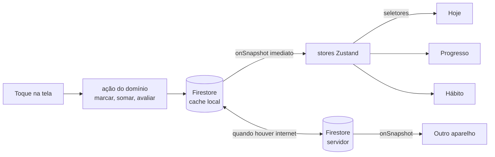

# Como as telas conversam

Este documento explica como uma ação numa tela aparece nas outras: de onde vêm os dados, como a escrita funciona sem internet, como o "Desfazer" volta atrás, o que muda em cada tela depois de cada ação e quando o dia vira.

## A regra principal

**As telas não passam dados umas para as outras.** Toda tela lê do mesmo lugar, e a navegação só leva identificadores (o id do hábito, a data). Quando a folha da proteína grava um ovo, o Hoje, o Progresso, o Hábito e o computador ao lado se atualizam sozinhos, porque todos estão ouvindo o mesmo dado.

## Camadas

| Camada | O que faz | Onde fica |
|---|---|---|
| **Firestore com cache persistente** | Fonte única dos dados. Grava primeiro no aparelho e sobe quando houver internet | `src/data/firebase.ts` (`persistentLocalCache` com `persistentMultipleTabManager`) |
| **Ouvintes** | Um `onSnapshot` por coleção da pessoa, aberto ao entrar, fechado ao sair | `src/data/listeners.ts` |
| **Stores (Zustand)** | Dados normalizados por id e por dia, mais o estado de interface | `src/stores/` |
| **Domínio** | Funções puras: constância, força do hábito, dias sem, correlações, dia lógico. Testadas com Vitest | `src/domain/` |
| **Ações** | Funções que a interface chama (`markHabit`, `setMark`, `addEntry`, `rate`, `logSlip`, `editSlip`, `deleteSlip`, `saveCheckin`, `logMeasurement`, `skipToday`, `useBudget`, `archiveHabit`, `startPause`, `startPhase`...). Cada uma grava e devolve como desfazer | `src/actions/` |
| **Telas e componentes** | Leem com seletores e chamam ações. Não conhecem o Firestore | `src/screens/`, `src/components/` |

Convenção de nomes: no código, tudo em inglês (tipos, coleções, componentes, ações). Rotas e textos da interface ficam em português, porque a pessoa vê.

## Os dados (resumo)

Tudo da pessoa fica em `users/{uid}/...`, e as regras do Firestore só deixam a própria pessoa ler e escrever.

| Coleção | Um documento é | Id |
|---|---|---|
| `profile` (documento único) | Nome, fuso, hora da virada do dia, preferências (tema, animações, som) | `profile` |
| `pillars` | Um pilar: nome, cor, ícone, ordem, arquivado | gerado |
| `habits` | Um hábito: pilar, tipo, meta, momento do dia, dias da agenda, fase, arquivado | gerado |
| `marks` | O estado de um hábito num dia: feito, horário, nota, valor | `{day}_{habitId}` |
| `entries` | Uma entrada de contador, com quantidade: ovo × 3 (18 g) às 7h10, 500 ml às 8h05 | gerado |
| `slips` | Um deslize de um hábito "dias sem" | gerado |
| `checkins` | Humor, energia, 3 coisas boas, minutos de tela e de YouTube | `{day}` |
| `measurements` | Peso ou cintura | gerado |
| `pauses` | Início, fim, motivo e quais hábitos (ou todos) | gerado |
| `phases` e `reviews` | Fase atual, datas, constância de fechamento; respostas da revisão | `{number}`, `{week}` |
| `runs` | Um treino de corrida: semana, sessão, hora de início, pausas e situação | gerado |

- Fora de `users/{uid}` ficam só as coleções do "A dois" (`invites` e `links`), com regras próprias: cada pessoa lê só o que a outra escolheu compartilhar.
- O id `{day}_{habitId}` torna a marca idempotente: marcar duas vezes no mesmo dia escreve o mesmo documento, e desfazer é apagar ou voltar o valor anterior.
- **Dias sem:** a contagem atual vai do último deslize até hoje, o recorde é a maior contagem e o total soma os dias inteiros sem o hábito desde o começo. O dia de um deslize não entra no total.
- Contadores são a soma das `entries` do dia, e não um número guardado. Assim, apagar o ovo errado corrige o total, e dois aparelhos somando ao mesmo tempo nunca brigam.
- Constância, força, dias sem e correlações são calculados no aparelho, a partir das marcas. Um ano de uso são poucos milhares de documentos, o que cabe com folga.

## Escrever sem esperar

1. A tela chama a ação, por exemplo `markHabit(habitId, day)`.
2. A ação grava no Firestore. O cache local responde na hora, e o `onSnapshot` dispara com `hasPendingWrites: true`.
3. O store atualiza e a interface anima (nível 1 da escada de celebração).
4. Quando houver internet, o Firestore sobe a escrita. Não existe "salvando..." nem botão de tentar de novo para o caso comum.

Uma escrita recusada pelo servidor (regra de segurança, conta sem acesso) desfaz o valor local e mostra um toast: "Não deu para salvar. Tente de novo em instantes."

## Desfazer

- Toda ação devolve o seu inverso: marcar devolve desmarcar, somar um item devolve apagar esse item, registrar um deslize devolve apagar o deslize, arquivar devolve desarquivar.
- O toast "Desfazer" fica 5 s na tela. Existe uma ação desfazível por vez: uma ação nova substitui o toast anterior, e a anterior fica valendo.
- O desfazer grava o inverso na hora. Não existe escrita "pendente" esperando o toast sumir, porque o app pode fechar a qualquer momento.
- O desfazer anima pelo mesmo caminho da ação, sem celebração.

## Onde cada ação aparece

| Ação | Onde | Muda | Como aparece |
|---|---|---|---|
| Marcar a caminhada | Hoje | Linha feita, bolinhas 3 de 7, "4 de 12 feitos hoje", anel de hoje na semana | Coreografia de [movimento.md](movimento.md) |
| | Hábito | Célula de hoje no heatmap, força, "3 de 7" | Ao abrir: valores novos, sem animação |
| | Progresso | Barras de Família e Corpo, constância da semana | Ao abrir: as barras enchem do valor guardado ao novo |
| | Outro aparelho | Tudo acima | Troca suave em `micro`, sem celebração |
| Somar um ovo | Folha da proteína | Total, barra, lista de hoje | NumberFlow, segmento novo enche em `fill`, item entra no topo da lista |
| | Hoje | Cartão da proteína | Igual à folha, quando a folha fecha |
| | Progresso › Alimentação | Barra de hoje | Ao abrir |
| Bater a meta da proteína | Folha e Hoje | Selo "meta batida", linha de meta acesa | Nível 2 da escada |
| Salvar o check-in | Hoje | O cartão do check-in vira um resumo com os dois rostinhos | Troca de altura com layout `calma` |
| | Progresso › Humor | Célula do dia, médias | Ao abrir |
| | Correlações | Recalculadas; só aparecem com 7 dias com e 7 sem | Ao abrir |
| Registrar um deslize | Hábito e Hoje | Contagem atual vai a 0; recorde e total ficam | NumberFlow devagar até 0 |
| Registrar o peso | Progresso › Medidas | Ponto novo, média de 7 dias, frase da tendência | O ponto entra com escala; a linha se redesenha em `fill` |
| Pausar | Hoje | O dia vira o estado pausado | Troca de tela com opacidade em `base` |
| | Progresso e Hábito | Dias pausados hachurados e fora das contas | Ao abrir |
| Mudar um horário | Hoje | Metas dos hábitos de horário (a partir de hoje; um registro já feito guarda a meta antiga); grupo do momento do dia | Na próxima vez que o Hoje aparece, sem animação de troca |
| Mudar a cor de um pilar | Todas | Tudo daquele pilar | A cor muda em `base` (as variáveis de cor animam) |
| Arquivar um hábito | Hoje | A linha sai | Altura e opacidade recolhem em `base`, com toast "Desfazer" |
| Começar a fase 3 | Hoje | Hábitos novos com o selo "novo" no primeiro dia | Cascata ao abrir o Hoje depois da fase desbloqueada |
| | Jornada | Fase 2 concluída, fase 3 "agora" | Ao abrir |
| | Ajustes | "Fases 3 de 4" | Ao abrir |

"Ao abrir" quer dizer: a tela que não estava visível durante a ação mostra o valor novo quando aparece. Na primeira vez que ela aparece na sessão, os gráficos se desenham uma vez, como entrada. Depois disso, ela anima a partir do último valor que mostrou.

## Estado de interface

Um store separado (`ui`) guarda o que não é dado da pessoa:

| Estado | Guardado em | Por quê |
|---|---|---|
| Folha aberta, dia escolhido, filtros do Progresso | URL | Voltar, recarregar e link direto funcionam |
| Último caminho de cada aba e rolagem de cada tela | Memória (`ui`) | Cada aba tem a própria pilha |
| Toast atual e o desfazer dele | Memória (`ui`) | Um por vez |
| Rascunho do check-in e da revisão | `localStorage` | Fechar sem querer não perde o texto |
| Tema, animações, som | `profile` no Firestore, com cópia no `localStorage` | A cópia local pinta a primeira tela no tema certo antes do Firestore responder |
| Dia fechado já celebrado | `localStorage`, por dia | O brilho acontece uma vez por dia |

## A conta do dia

O cartão da semana do Hoje mostra "x de 12 feitos hoje". A conta segue estas regras:

- **Contam:** hábitos de marcar, de horário e de nota agendados para o dia, e os hábitos "dias sem", que contam como feitos enquanto não houver deslize no dia.
- **Não contam:** contadores (proteína e água, que têm barra própria), limites da semana e medidas (peso, cintura).
- **Saem da conta:** hábitos pausados, fora da agenda ou com "hoje não se aplica".
- **Parcial:** um hábito com mínimo configurado (caminhada de 12 min, com meta de 20 e mínimo de 10) conta como feito na conta do dia e como meio dia na constância e na força.
- **Deitar:** conta no dia em que a pessoa deitou, mas é marcado na manhã seguinte, na folha "Acordei às", que pergunta as duas horas. Por isso o dia fecha em 11 de 12 na noite da história.
- Na quinta da história: 3 às 7h42, 4 às 12h41, 5 às 15h20, 8 às 20h34, 9 às 20h36 e 11 às 21h04.

## O dia lógico

- O dia vira às **4h**, no fuso do perfil (São Paulo por padrão). Deitar à 0h30 conta na noite anterior, e o check-in feito às 23h50 continua sendo do mesmo dia. A hora da virada fica no perfil, para quem tiver outra rotina.
- A semana começa na segunda.
- Com o app aberto na hora da virada, um temporizador troca o Hoje para o dia novo com opacidade em `base`. Ao voltar para a frente depois da virada, a troca acontece antes da primeira pintura.
- Dias pausados e dias fora da agenda saem da conta da constância e da força.

## Sincronização entre aparelhos

- iPhone e computador da mesma conta mostram a mesma coisa em cerca de 1 s, pelos ouvintes.
- Duas abas no computador compartilham o cache (`persistentMultipleTabManager`).
- Conflitos são raros pelo desenho dos dados: marcas têm id por dia e hábito (a última escrita vale), e contadores são itens separados (nada se perde).

## Sem internet

- Tudo funciona: ler, marcar, somar, salvar o check-in. As escritas ficam na fila do Firestore.
- Um aviso discreto aparece no topo do Hoje enquanto não houver internet e some quando ela voltar (o estado está em [estados.md](estados.md)).
- Sair da conta com escritas na fila pede confirmação, porque elas se perderiam: "Ainda há registros esperando internet para subir."

## Versão nova do app

- O `vite-plugin-pwa` fica em modo de aviso (`registerType: 'prompt'`).
- Quando houver versão nova, aparece o toast "Nova versão do Prokopē" com "Atualizar". Ele nunca aparece com folha ou tela cheia aberta; espera a pessoa voltar a uma aba.
- Se a pessoa não atualizar, a versão nova entra na próxima vez que o app abrir do zero.

## Ciclo de vida

Ao voltar para a frente (`visibilitychange`), nesta ordem:

1. Confere se o dia virou e troca o Hoje.
2. Reorganiza o Hoje pelo horário (check-in no topo depois das 20h30, revisão no dia e na hora escolhidos).
3. Retoma a corrida em andamento, recalculando o tempo pela hora de início.
4. Procura versão nova do app.
