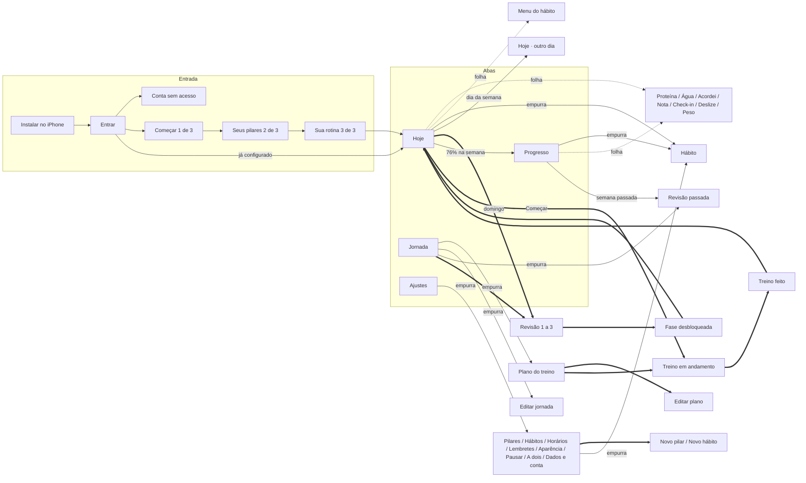

# Navegação

Como a pessoa anda pelo app: o mapa das telas, as rotas, os quatro tipos de passagem entre telas e a animação de cada um, o que fica guardado ao trocar de aba e como o app funciona no computador. Os nomes de animação (`calma`, `folha`, `micro`...) vêm de [movimento.md](movimento.md).

## Mapa

Legenda: seta cheia é tela empurrada, pontilhada é folha, dupla é tela cheia.

## Quatro tipos de passagem

| Tipo | Quando usar | Barra de abas | Como sai |
|---|---|---|---|
| **Aba** | As quatro áreas do app | Fica | Outra aba |
| **Tela empurrada** | Detalhe de algo da lista (hábito, plano, um item de Ajustes) | Fica | "Voltar" no topo ou arrasto da borda esquerda |
| **Folha** | Registrar ou escolher algo rápido sem perder o lugar | Coberta pelo fundo | Arrastar para baixo, tocar fora, "Fechar" ou a ação principal |
| **Tela cheia** | Um fluxo com começo e fim, que pede foco (entrada, treino, revisão, fase desbloqueada, criar pilar ou hábito, editar o plano do treino) | Some | Depende da forma (abaixo) |

Regra de escolha: se a pessoa volta ao mesmo lugar depois de uma ação de segundos, é folha. Se ela vai explorar e voltar, é tela empurrada. Se ela entra num fluxo de vários passos, é tela cheia.

A tela cheia tem duas formas:

| Forma | Onde | Topo | Como sai |
|---|---|---|---|
| **Fluxo em passos** | Primeiro acesso, revisão da semana | `StepTop`: voltar · trechos do progresso · X | Voltar entre passos. Na revisão, o X sai e guarda o que foi preenchido, e o Hoje mostra "Continuar revisão". O primeiro acesso não tem X, porque ainda não existe um Hoje para onde voltar |
| **Formulário** | Novo pilar, novo hábito, Editar plano | `NavBar`: Cancelar · título · Criar (ao criar) ou Salvar (ao editar) | Cancelar, ou a ação, que fica desabilitada até o campo obrigatório ser preenchido. No Treino guiado, a linha "Plano · 13 semanas" empurra o editor dentro do próprio formulário ("‹ Novo hábito" volta), com o passo de 24 px |
| **Momento** | Treino em andamento, fase desbloqueada | Treino: "Minimizar" (seta para baixo). Fase: nenhum | O treino minimiza e segue numa faixa no topo do Hoje; "Encerrar" pede toque longo. A fase sai pelo botão "Ver meu dia" |

## Animação de cada passagem

| Passagem | Entrada | Saída | Reduzido |
|---|---|---|---|
| Trocar de aba | O conteúdo troca com opacidade em `micro`, sem deslocamento. O ícone da aba passa de Regular para Fill com a mola `toque` | — | Igual |
| Tocar na aba ativa | Volta à raiz da aba; se já está na raiz, rola até o topo com `calma` | — | Rola sem animação |
| Empurrar | A tela nova entra da direita com `calma`; a anterior recua 25% e escurece 6% | O inverso | Opacidade em `micro` |
| Voltar pelo arrasto | A tela segue o dedo; ao soltar, completa se passou de 35% da largura ou a velocidade passou de 500 px/s, senão volta | — | O arrasto continua; a soltura troca por opacidade |
| Abrir folha | Sobe com a mola `folha`; o fundo escurece em `base` | Desce em `base` com `--ease-exit` | Opacidade em `micro` |
| Arrastar folha | Segue o dedo com resistência acima da altura natural; fecha ao passar de 30% da altura ou de 600 px/s, com a mola `folha` levando a velocidade do dedo (a curva `--ease-exit` daria um tranco). Se não passar, volta com a mesma mola | — | Igual |
| Abrir tela cheia | Sobe 24 px com opacidade em `base` | Desce 24 px com opacidade em `micro` | Opacidade em `micro` |
| Passo de um fluxo (revisão, entrada) | O conteúdo novo entra 24 px pela direita com opacidade; o trecho da barra de progresso enche em `fill` | Voltar faz o inverso | Opacidade em `micro`; a barra enche igual |
| Ver outro dia (semana do topo) | A lista troca com opacidade e 12 px na direção do tempo (o passado vem da esquerda); a faixa "você está vendo um dia que passou" desce em `base` | "Voltar para hoje" faz o inverso | Opacidade em `micro` |

As passagens entre telas usam o Motion (`AnimatePresence` com a rota anterior congelada), e não a View Transitions API, porque o voltar pelo arrasto precisa seguir o dedo e poder ser interrompido.

## Rotas

O primeiro trecho da rota diz qual aba está ativa. Folhas e o dia escolhido ficam nos parâmetros da URL: assim o voltar do navegador fecha a folha no computador, recarregar a página mantém o lugar, e um link pode abrir uma folha direto.

| Rota | Tela | Tipo |
|---|---|---|
| `/instalar` | Instalar no iPhone (só no Safari, fora da Tela de Início) | Tela cheia |
| `/entrar` | Entrar com Google | Tela cheia |
| `/comecar/1` a `/comecar/3` | Primeiro acesso | Tela cheia |
| `/convite/:id` | Convite do A dois aberto pelo link: entra com Google se preciso e abre o Hoje com a folha do convite | Tela cheia |
| `/hoje` (e `/` redireciona para cá) | Hoje | Aba |
| `/hoje?dia=2026-10-21` | Hoje · outro dia | Aba (mesma tela) |
| `/hoje/habito/:id` | Hábito, aberto a partir do Hoje | Empurrada |
| `/progresso?periodo=semana&tema=visao` | Progresso. `periodo` é `semana`, `mes` ou `fase`; `tema` é `visao`, `humor`, `medidas` ou o id de um pilar | Aba |
| `/progresso/habito/:id` | Hábito, aberto a partir do Progresso | Empurrada |
| `/jornada` | Jornada | Aba |
| `/jornada/treino/:id` | O plano de um treino guiado (a corrida, a bicicleta) | Empurrada |
| `/jornada/treino/:id/plano` | Editar plano (as semanas do treino guiado) | Tela cheia |
| `/jornada/corrida` | Rota antiga: leva ao plano do primeiro treino guiado | Empurrada |
| `/jornada/revisoes/:semana` | Revisão passada, só leitura | Empurrada |
| `/progresso/revisoes/:semana` | A mesma revisão, aberta a partir do Progresso (rota espelho) | Empurrada |
| `/jornada/fases` | Editar jornada (sugestão aos 70%, datas e duração, os hábitos de cada fase: os que continuam, os novos, adicionar, parar nesta fase) | Empurrada |
| `/treino/:habito/:semana/:treino` | Treino em andamento, com os blocos do plano do hábito | Tela cheia |
| `/treino/:habito/:semana/:treino/feito` | Treino feito | Tela cheia |
| `/corrida/:semana/:treino` e `/corrida/:semana/:treino/feito` | Rotas antigas: o treino do primeiro treino guiado (com mais de um treino guiado, as telas usam as rotas com `:habito`) | Tela cheia |
| `/revisao/:semana/1` a `/revisao/:semana/3` | Revisão de domingo | Tela cheia |
| `/revisao/:semana/fim` | Revisão · mais uma semana (o fim da revisão quando a pessoa fica mais uma semana na fase) | Tela cheia |
| `/fase/:numero` | Fase desbloqueada | Tela cheia |
| `/ajustes` | Ajustes | Aba |
| `/ajustes/pilares`, `/ajustes/pilares/:id` | Pilares e o detalhe de um pilar | Empurrada |
| `/ajustes/pilares/:id/editar` | Editar um pilar (o mesmo formulário do novo, com "Salvar") | Tela cheia |
| `/ajustes/pilares/novo` | Novo pilar | Tela cheia |
| `/ajustes/habitos`, `/ajustes/habitos/:id` | Hábitos e o hábito | Empurrada |
| `/ajustes/habitos/novo/tipo`, `/ajustes/habitos/novo/detalhes` | Novo hábito | Tela cheia |
| `/ajustes/horarios`, `/lembretes`, `/aparencia`, `/pausar`, `/a-dois`, `/dados` | Itens de Ajustes | Empurrada |

**Folhas** (sobre qualquer aba): `?folha=proteina`, `agua`, `acordar`, `nota&refeicao=almoco`, `checkin`, `peso`, `deslize&habito=:id`, `menu&habito=:id`, `jeito` (o jeito de ver o Hoje: Resumo, Lista completa ou Linha do tempo), `corrigir&habito=:id&dia=:dia` (corrigir um dia do hábito), `dia&dia=:dia` (o resumo de um dia no Progresso) e `apagar&pilar=:id` (apagar um pilar com hábitos).

**Rotas espelho:** uma tela empurrada aberta a partir de outra aba abre dentro da aba atual, com o primeiro trecho da rota dessa aba (`/progresso/habito/:id`, `/progresso/revisoes/:semana`). Assim a aba não troca sozinha e o "Voltar" leva de volta para onde a pessoa estava.

Abrir uma folha cria uma entrada no histórico; fechar volta. Passos de um fluxo de tela cheia trocam a entrada (`replace`), para que o voltar do navegador saia do fluxo inteiro em vez de desfazer passo a passo.

## O que fica guardado

- **Cada aba tem a própria pilha.** Ao sair de Ajustes › Pilares para o Hoje e voltar, a pessoa reencontra Pilares. O último caminho de cada aba fica no estado de interface (veja [comunicacao.md](comunicacao.md)).
- **Rolagem:** cada tela guarda a posição ao sair e restaura ao voltar. Ao empurrar uma tela nova, ela começa no topo.
- **Rascunhos:** check-in e revisão salvam o texto enquanto a pessoa digita (no aparelho). Fechar sem querer não perde nada, e por isso fechar não pede confirmação.
- **Fluxos interrompidos:** sair da revisão no passo 2 e voltar depois abre no passo 2. O treino em andamento sobrevive a um recarregamento, porque o tempo é calculado a partir da hora de início.

## Voltar no app instalado

O app instalado no iPhone não tem a barra do Safari nem o voltar do sistema. Por isso:

- Toda tela empurrada tem "Voltar" no topo, com o nome da tela anterior.
- O arrasto a partir da borda esquerda (zona de 20 px) volta, como nos apps nativos. Ele só existe no app instalado: no Safari comum, o próprio navegador já tem esse gesto.
- Folhas fecham pelo arrasto, pelo toque fora ou pelo botão.
- Telas cheias sempre têm um X ou um caminho claro de saída.

## Entrar no app a partir de fora

- **Pelo ícone na Tela de Início:** abre a última aba usada, se faz menos de 30 minutos; depois disso, abre o Hoje.
- **Contexto do horário:** ao voltar para a frente (`visibilitychange`), o Hoje se reorganiza pelo horário. Entre 20h30 e 21h, o check-in sobe para o topo. No dia da revisão (domingo às 18h por padrão, configurável em Horários), o convite aparece no topo e fica até dois dias depois.
- **Links diretos** (`/hoje?folha=agua`, `/revisao/...`): funcionam no computador e no navegador. No iPhone, um link aberto pelo app Atalhos abre no Safari, e não no app instalado, que guarda os dados separado. Por isso os alarmes do iPhone só lembram, e o contexto do horário faz o resto quando a pessoa abre o app. Confirmar esse comportamento no aparelho, porque pode mudar entre versões do iOS.

## No computador

- A barra de abas vira uma barra lateral com as mesmas quatro áreas e a lista de pilares.
- Telas empurradas ocupam a área principal, com "Voltar" no topo, e trocam com opacidade em `base`, sem deslizar, porque não há gesto de arrasto.
- Folhas viram um painel de 420 px à direita, que entra com opacidade e 16 px de deslocamento em `base`. O Hoje continua visível ao lado, então a pessoa vê a proteína subir na lista enquanto registra.
- Telas cheias viram um cartão central de até 560 px sobre o fundo escurecido, com opacidade e escala de 0,98 para 1 em `base`.
- `Esc` fecha folha, diálogo e tela cheia. O foco volta ao elemento que abriu.
- Os atalhos de teclado do computador estão em [telas/entrada.md](telas/entrada.md).
